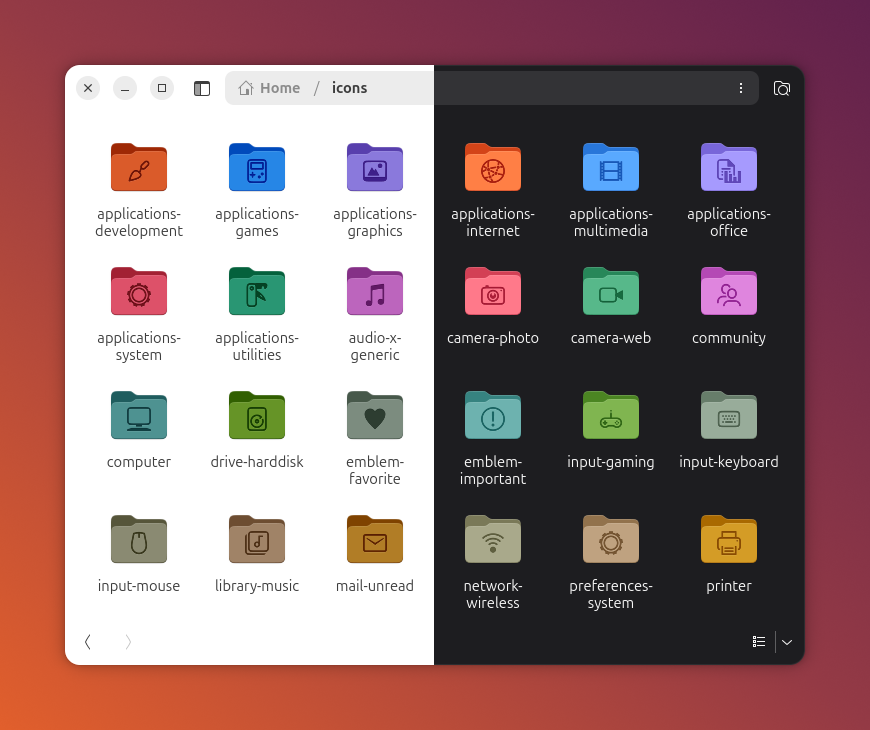

# Yaru folder icons

Ready-made folder icons for Ubuntu's **Yaru** theme: Yaru's own folder with a symbol on it, drawn in Yaru's embossed style. 1323 symbols for each of
the 26 Yaru colour variants, as scalable SVG.



## Download

Get the archive for your Yaru variant from the
[latest release](https://github.com/VladyslavChernyshov/yaru-folder-icons/releases/latest).
Archives are named `yaru-folder-icons-<variant>-svg.zip`; `SHA256SUMS.txt` lists their checksums.

| Accent | Light | Dark |
|---|---|---|
| Orange (Ubuntu default) |  `Yaru` |  `Yaru-dark` |
| Bark |  `Yaru-bark` |  `Yaru-bark-dark` |
| Blue |  `Yaru-blue` |  `Yaru-blue-dark` |
| Magenta |  `Yaru-magenta` |  `Yaru-magenta-dark` |
| Olive |  `Yaru-olive` |  `Yaru-olive-dark` |
| Prussian green |  `Yaru-prussiangreen` |  `Yaru-prussiangreen-dark` |
| Purple |  `Yaru-purple` |  `Yaru-purple-dark` |
| Red |  `Yaru-red` |  `Yaru-red-dark` |
| Sage |  `Yaru-sage` |  `Yaru-sage-dark` |
| Viridian |  `Yaru-viridian` |  `Yaru-viridian-dark` |
| Warty brown |  `Yaru-wartybrown` |  `Yaru-wartybrown-dark` |
| Yellow |  `Yaru-yellow` |  `Yaru-yellow-dark` |
| MATE |  `Yaru-mate` |  `Yaru-mate-dark` |

Pick the variant you use in Settings → Appearance (style and accent colour). You can mix variants:
a red folder in an orange desktop is a good way to make one folder stand out.

## Use

Unpack the archive somewhere permanent (Nautilus keeps a link to the file, so don't move it later):

```bash
mkdir -p ~/.local/share/folder-icons
unzip yaru-folder-icons-Yaru-svg.zip -d ~/.local/share/folder-icons
```

Apply an icon to a folder (the file name is the symbol's name):

```bash
gio set ~/Music metadata::custom-icon file://$HOME/.local/share/folder-icons/Yaru/audio-x-generic.svg
```

Go back to the default icon:

```bash
gio set -t unset ~/Music metadata::custom-icon
```

If Nautilus doesn't update right away, reopen the window.

## Make your own

These icons are generated by [Folder Symbols](https://github.com/VladyslavChernyshov/folder-symbols),
which can put any symbol on a folder, in PNG or SVG, and apply it for you.

## Licence

The icons are adaptations of artwork from [Yaru](https://github.com/ubuntu/yaru) (the Yaru
project contributors and Canonical Ltd.) and are shared under the same licence,
[Creative Commons Attribution-ShareAlike 4.0](LICENSE) (CC BY-SA 4.0). They combine Yaru's folder
with a Yaru symbol and reproduce Yaru's emboss effect. No endorsement by Yaru, Canonical or the
original authors is implied. See [NOTICE.md](NOTICE.md).
